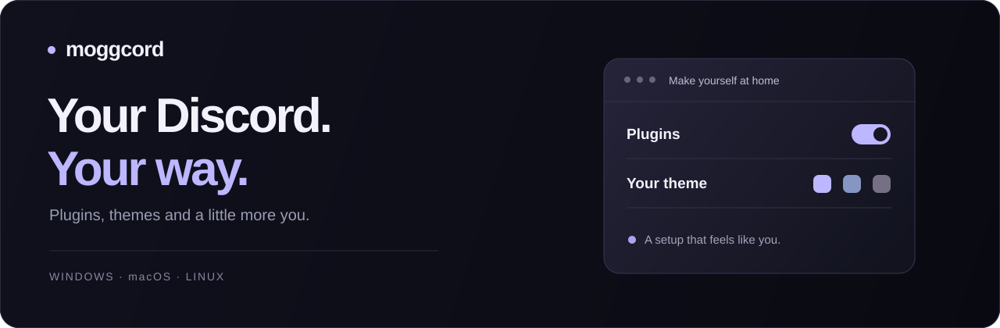

<div align="center">



# Moggcord

**Make Discord feel like yours.** Plugins, themes and community uploads for your desktop.

[](https://github.com/caedesdev/moggcord/releases/latest)
[](LICENSE)
[](https://github.com/caedesdev/moggcord/actions/workflows/docs.yml)

[**Download**](https://github.com/caedesdev/moggcord/releases/latest) · [Documentation](docs/README.md) · [Website](https://moggcord.cc) · [Contribute](CONTRIBUTING.md) · [♡ Support](docs/donations.md)

</div>

## Get Moggcord

| Your platform | Download | Status |
| --- | --- | --- |
| Windows x64 | [Windows installer](https://github.com/caedesdev/moggcord/releases/latest/download/Moggcord-Installer.exe) | Desktop setup |
| macOS Intel & Apple Silicon | [Universal DMG](https://github.com/caedesdev/moggcord/releases/latest/download/Moggcord-Installer-macOS.dmg) | Preview; not Apple notarized |
| Linux x64 | [AppImage](https://github.com/caedesdev/moggcord/releases/latest/download/Moggcord-Installer-Linux.AppImage) · [DEB](https://github.com/caedesdev/moggcord/releases/latest/download/Moggcord-Installer-Linux.deb) | Preview; official Discord DEB/TAR installations |

Open the installer, choose **Install**, **Repair** or **Uninstall**, then select your Discord installation. The selected Discord channel closes and restarts during installation. Stable, Canary and PTB are separate installations.

Start with the [installation guide](docs/getting-started/installation.md) for requirements and custom locations. There is no Android installer in this release line. Release downloads contain the latest **published** version; `main` can include changes that have not shipped yet.

## Make it yours

| Plugins | Themes | Community |
| --- | --- | --- |
| Built-in Moggcord and Vencord plugin collections. Choose what to enable in settings. | Add local themes, online stylesheets or your own QuickCSS. | Browse community uploads and install them through the local connector. |
| [Explore plugins](docs/guides/plugins.md) | [Set up a theme](docs/guides/themes.md) | [Connect your computer](docs/community/setup.md) |

Saved plugin choices and platform restrictions affect what is active. Community installation needs a connector on **each visitor's computer** and uses that visitor's selected Discord channel. See [Downloads and sharing](docs/community/installing-and-sharing.md).

The client updater checks downloaded desktop files before applying them. [Updates and repair](docs/guides/updates-and-repair.md) explains progress, cancellation and recovery.

## Find your next step

| I want to… | Start here |
| --- | --- |
| Set up Moggcord for the first time | [First steps](docs/getting-started/first-steps.md) |
| Move my settings to another computer | [Backup and restore](docs/guides/backup-and-restore.md) |
| Fix a failed update or a broken client | [Troubleshooting](docs/troubleshooting/README.md) |
| Report a bug | [Bug report](https://github.com/caedesdev/moggcord/issues/new?template=bug_report.yml) |
| Suggest an improvement | [Feature request](https://github.com/caedesdev/moggcord/issues/new?template=feature_request.yml) |
| Write a plugin or understand the code | [Plugin development](docs/developers/plugin-development.md) · [Architecture](docs/architecture/README.md) |

## Support Moggcord

If Moggcord is useful to you, you can support the project with **Litecoin, Bitcoin or Solana**. Choose your own amount and send directly from your wallet.

**[Donation addresses and QR codes →](docs/donations.md)**

You can also help by reporting reproducible bugs, improving the docs or [contributing code](CONTRIBUTING.md).

## Development

Use Node.js 24 and the pnpm version pinned in [package.json](package.json).

```sh
git clone https://github.com/caedesdev/moggcord.git
cd moggcord
pnpm install --frozen-lockfile
pnpm buildStandalone
```

Building does not inject the result into Discord. Read [Development setup](docs/developers/setup.md) before installing a local build. Installer packaging, tests and release publication have separate [maintainer instructions](docs/developers/releasing.md).

## Credits and license

Moggcord is a fork of [Equicord](https://github.com/Equicord/Equicord), which builds on [Vencord](https://github.com/Vendicated/Vencord). Their source, APIs and contributors are a substantial part of this project. Existing copyright and license notices remain in the source.

The project is licensed under [GPL-3.0](LICENSE). Moggcord is not affiliated with Discord. Read [Trust and privacy](docs/guides/trust-and-privacy.md) before installing client modifications or community code.
