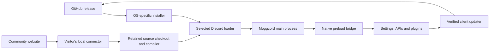

# System architecture

[Documentation](../README.md) / Architecture

Moggcord has three related but separate paths: a desktop installer, the client code running inside Discord, and an optional connector for website-driven community installation.

The arrows show dependencies/data flow, not a shared server process. Each visitor's connector and Discord installation run on that visitor's computer.

## Components and boundaries

| Component | Runs where | Main responsibility |
| --- | --- | --- |
| Windows installer | User's Windows PC | .NET host/backend and the installer interface |
| macOS/Linux installer | User's desktop | Electron host, validated embedded build and pinned native patch helper |
| Injected main process | Selected Discord application | Host integration, settings files, native helpers, IPC and updates |
| Preload/native bridge | Discord window preload | Expose named native operations to the renderer |
| Renderer | Discord's UI process | Plugin registry/lifecycle, webpack patches, settings and styling |
| Community website | Website host and browser | Upload metadata, public manifests and download/install controls |
| Community connector | Loopback service on the user's PC | Validate, compile, activate, deploy and restart one selected channel |

## Three kinds of data

**Source** is the checkout and community files under `src/userplugins`. **Build output** is the compiled patcher, preload, renderer and stylesheet. **User data** is settings, themes and plugin data. Keeping source or settings does not guarantee that a new official build still contains a privately installed plugin.

The current [file-location reference](../reference/file-locations.md) distinguishes these directories. A settings backup is not a source backup; a repair operation is not a website connector setup.

## Verification boundaries

Build metadata records the desktop version and four file fingerprints. Installers/update operations verify that metadata. The community path separately checks package identity, allowed paths/imports and a content fingerprint before deployment.

These checks detect mismatches and incomplete packages. They do not prove that a third-party plugin is safe or compatible with every Discord build. See [Trust and privacy](../guides/trust-and-privacy.md).

## Follow a flow

- [Client startup and updates](client-lifecycle.md): from Discord's loader to running plugin code and a verified update.
- [Community installation](community-installation.md): from a website click to local compilation, deployment and rollback.
- [Project layout](../developers/project-layout.md): source locations for each component.
