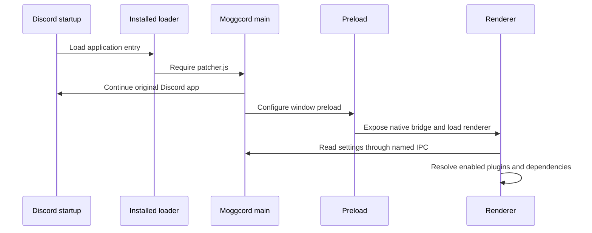

# Client startup and update lifecycle

[Documentation](../README.md) / Architecture / Client lifecycle

## Startup

The installer changes the selected Discord application's startup loader so it loads Moggcord's `patcher.js`. The loader resolves a deployed desktop build; it does not compile community source at Discord startup.

The patcher initializes main-process integration and loads the original Discord application. Moggcord supplies the window preload used to expose native operations and load the renderer. The renderer constructs the plugin registry, applies supported patches and starts enabled plugins/dependencies.

## Native bridge

`src/VencordNative.ts` exposes renderer-facing methods. `src/shared/IpcEvents.ts` defines the named channels, and main-process handlers implement the corresponding operations. Shared progress types keep the updater status contract consistent.

When adding a native operation, review both ends of IPC and any disabled/web fallback. Do not expose a generic arbitrary-command or arbitrary-file operation just to make a UI task easier.

## Client updates

1. The HTTP updater reads the latest release metadata and compares versions.
2. It selects `moggcord-update.zip`, falling back to `moggcord-dist.zip` when the small archive is absent.
3. A bounded streaming download writes a temporary file and tracks actual bytes.
4. Extraction occurs in a fresh workspace. The expected version and desktop fingerprints are verified.
5. Existing destinations are backed up, the new files copied, and the deployed build checked again.
6. On success, pending update state is cleared and the UI schedules a restart. On apply failure, copied destinations are restored and the failure is reported.

The in-memory process still contains its previous code after disk replacement. A complete restart loads the new patcher/preload/renderer together. This is why a window reload can leave a version mismatch.

## Discord host updates

A Discord application update and a Moggcord client update are different operations. The Windows host integration can repair loader placement after a Discord app update. If Moggcord settings disappear, use the latest installer's Repair action for the actual channel rather than repeatedly importing settings.

## Source of truth

[Patcher](../../src/main/patcher.ts) · [Loader resolution](../../src/main/moggcordLoader.ts) · [Native bridge](../../src/VencordNative.ts) · [IPC events](../../src/shared/IpcEvents.ts) · [Plugin lifecycle](../../src/api/PluginManager.ts) · [Updater](../../src/main/updater/http.ts)
