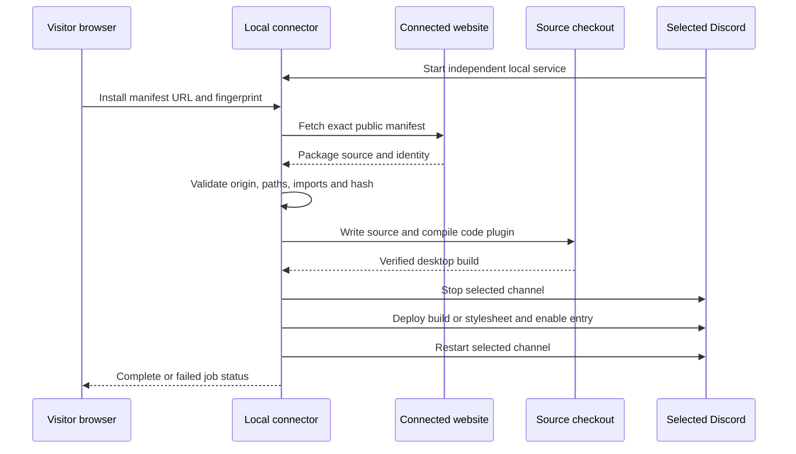

# Community installation flow

[Documentation](../README.md) / Architecture / Community installation

The website publishes a package; the visitor's local connector validates and installs it. There is no server-side operation that can directly write a plugin into every visitor's Discord directory.

In 1.18.46, the normal Moggcord update includes the local service. Moggcord starts it automatically and registers its install-link handler. A separate worker process keeps the installation job alive while Discord is stopped and restarted. The browser's local-app permission lets the website contact that worker; target detection and file operations happen locally.

Stylesheets skip the code-compilation step. They are saved as a local theme, enabled in settings and followed by the selected channel's restart.

## Origin and package validation

The managed service uses `https://moggcord.cc`; advanced manual setup records the chosen website origin. The local HTTP service checks the request Origin, Host and loopback address. State-changing POST routes require JSON and `X-Moggcord-Install: 1`.

The manifest URL must use the configured origin and the expected `/api/install/<uuid>` shape. Fetching disallows redirects. Source type, limits, entry point, paths and content fingerprint are checked before installation. The HTTP service does not accept arbitrary command names, process IDs or destination directories from the website.

This local validation is separate from website account authentication. A CAPTCHA or signed-in website account is not the local connector's authorization mechanism.

## Compile before stopping

For new or changed code plugins, source files are staged and compiled first. The managed service prepares its version-matched compiler package only when that build is needed, preserving retained community plugin source. An unchanged installed plugin can be enabled without downloading the compiler or rebuilding. A syntax error, absent import or unsupported package should fail before the selected Discord is stopped. Compilation is not a sandbox/security audit; installed plugin code executes when it is loaded by the client.

## Deployment and rollback

The connector snapshots files/settings that it changes. Deployment replaces the active compiled build and mirror, or writes the community stylesheet. It then writes activation settings and restarts the selected client.

A failure restores the replaced source/build/settings, removes newly introduced files where appropriate, and attempts to reopen the prior client if it was stopped. The browser polls a job state and receives an explanation instead of inferring success from a completed HTTP download.

## Installed inspection

Read-only inspection parses the selected compiled renderer's registered plugin definitions; it does not execute that renderer. For stylesheets it checks the community theme file. A requested entry can be installed but disabled. Version/fingerprint currency is a separate check used to avoid unnecessary reinstalls.

See the [protocol reference](../reference/community-protocol.md) for endpoints, capabilities and data shapes.

## Source of truth

[Automatic startup](../../src/main/community.ts) · [Managed service](../../scripts/community/service.mjs) · [Compiler preparation](../../scripts/community/compiler.mjs) · [Validated install and rollback](../../scripts/community/core.mjs) · [Browser polling and state](../../web/community-install.js) · [Shared package rules](../../web/plugin-package.js)
