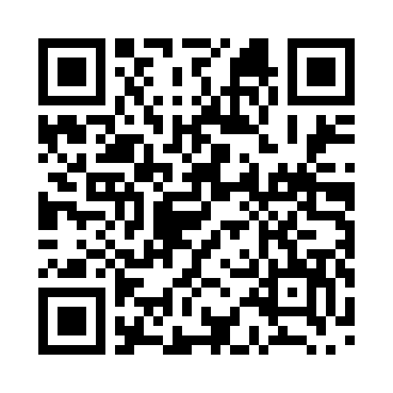

# Support Moggcord

[Moggcord](../README.md) / Support

Enjoying Moggcord? You can support the project with a direct crypto donation. Choose any amount in your wallet. There is no account to create or recurring payment to set up here.

| Coin | Network | Jump to address |
| --- | --- | --- |
| Litecoin (LTC) | Litecoin mainnet | [LTC address](#litecoin-ltc) |
| Bitcoin (BTC) | Bitcoin mainnet | [BTC address](#bitcoin-btc) |
| Solana (SOL) | Solana mainnet | [SOL address](#solana-sol) |

Use the listed native coin and network. These QR codes contain the **address only**, with no preset amount. After scanning, compare the address in your wallet with the text below before sending.

## Litecoin (LTC)

**Network: Litecoin mainnet**

```text
Lbg5o8fa7xnDALWzCRfEyNCnbwKeCrhQ23
```


## Bitcoin (BTC)

**Network: Bitcoin mainnet**

```text
bc1qkw787azu0u46fnghtsachhlkmjf975934tun38
```


## Solana (SOL)

**Network: Solana mainnet**

```text
7FaJ1CbjSZH6JrsZGpZ9w3vhYX7QHCrMqHzwnYq95tq9
```



## Other ways to help

Donations are optional. [Report a bug](https://github.com/caedesdev/moggcord/issues/new?template=bug_report.yml), [suggest an improvement](https://github.com/caedesdev/moggcord/issues/new?template=feature_request.yml), improve the documentation or [contribute code](../CONTRIBUTING.md).

[Back to Moggcord](../README.md) · [Documentation](README.md) · [Downloads](https://github.com/caedesdev/moggcord/releases/latest)
